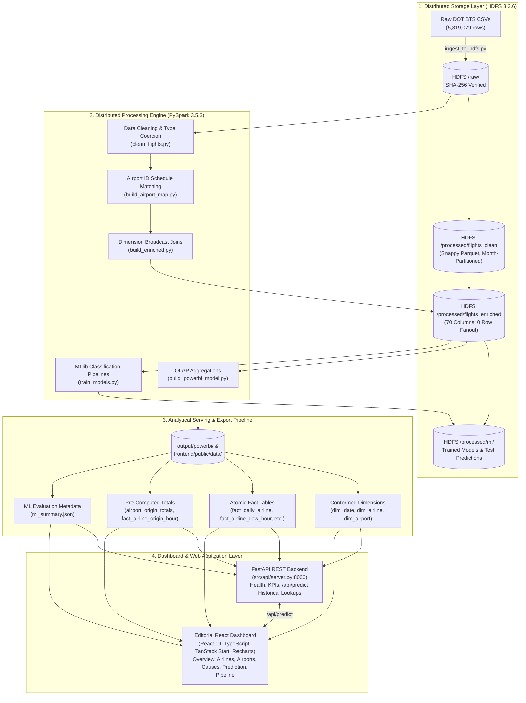

# Flight Delay Prediction and Analytics

An end-to-end Big Data analytics and machine learning pipeline for flight delay prediction and historical performance analytics using **VS Code**, **HDFS**, **Apache Spark / PySpark**, and **Power BI**.

---

## 📁 Project Architecture & Skeleton

```text
flight-delay-analytics/
├── .vscode/                  # VS Code interpreter settings and debug profiles
│   ├── settings.json
│   └── launch.json
├── config/
│   ├── config.yaml           # Centralized configuration (HDFS URIs, Spark tuning, local paths, holidays)
│   ├── feature_roles.yaml    # Column roles, ML features, labels, and target leakage taxonomy
│   └── hadoop/               # Hadoop core-site.xml and hdfs-site.xml configurations
├── data/
│   └── raw/                  # Local copies of input flight datasets (gitignored)
├── logs/                     # Application, pipeline, and verification logs (gitignored)
├── notebooks/                # Jupyter / exploratory analysis notebooks
├── output/
│   ├── profiling/            # Phase 2 raw data profiling markdown report
│   ├── cleaning/             # Phase 3 cleaning report & airport_id_map CSV
│   ├── enrichment/           # Phase 4 enrichment report (phase4_report.md)
│   └── powerbi/              # Aggregated analytical datasets exported for Power BI (gitignored)
├── scripts/                  # Shell utility scripts (start_hdfs.sh, stop_hdfs.sh, verification scripts)
│   └── phase3/               # Archived Phase 3 verification and execution scripts
├── src/
│   ├── __init__.py
│   ├── ingestion/            # Raw data ingestion into HDFS (ingest_to_hdfs.py)
│   ├── profiling/            # Raw data profiling pipeline (profile_raw.py)
│   ├── processing/           # Cleaning, mapping, enrichment, and validation
│   │   ├── build_airport_map.py
│   │   ├── clean_flights.py
│   │   ├── validate_clean.py
│   │   ├── build_dim_date.py
│   │   ├── build_enriched.py
│   │   └── validate_enriched.py
│   ├── analytics/            # SQL-based analytics and delay metrics aggregation
│   ├── ml/                   # Delay prediction feature engineering and MLlib models
│   ├── export/               # CSV/Parquet export pipeline for Power BI consumption
│   └── utils/
│       ├── __init__.py
│       ├── spark_session.py  # Reusable SparkSession builder with HDFS & resource tuning
│       └── test_setup.py     # End-to-end smoke test script
├── .gitignore
├── README.md
└── requirements.txt          # Python dependencies (PySpark, Pandas, PyArrow, etc.)
```

---

## 🏛️ End-to-End System Architecture

The platform implements a modern, decoupled Big Data architecture designed to ingest, process, model, and serve 5.82 million domestic flight records:



### 1. Distributed Storage Layer (Apache Hadoop HDFS)
- **Engine & Topology**: Apache Hadoop HDFS 3.3.6 running in pseudo-distributed mode on WSL2 (Ubuntu 22.04 LTS), configured with NameNode, DataNode, and SecondaryNameNode on port 9000.
- **Raw Data Ingestion (`/user/${USER}/flight_delay/raw/`)**: Stores immutable raw DOT BTS CSVs (`flights.csv`, `airports.csv`, `airlines.csv`) with automated SHA-256 byte-for-byte checksum verification.
- **Processed & Analytics Storage (`/user/${USER}/flight_delay/processed/`)**:
  - `flights_clean`: Snappy-compressed Parquet partitioned by `MONTH` (152.9 MB, 74.2% compression ratio).
  - `flights_enriched`: Full 70-column analytical baseline partitioned by `MONTH` (249.3 MB Snappy Parquet, 1 file per month).
  - `analytics/`: 19 pre-aggregated OLAP tables stored as single-part Parquet files (`coalesce(1)`).
  - `ml/`: Chronological dataset splits (`dataset/{train,val,test}`), persisted Spark MLlib model binaries (`models/{logistic_regression,gbt}`), and 932,084 test evaluation predictions (`predictions_test`).

### 2. Distributed Processing Engine (Apache Spark / PySpark)
- **Runtime Tuning**: PySpark 3.5.3 executed with OpenJDK 17 under session timezone `UTC`, tuned for WSL2: `master: local[6]`, `driver_memory: 5g`, `executor_memory: 5g`, `shuffle_partitions: 24`, and `spark.hadoop.dfs.replication=1`.
- **Pipeline Stages**:
  1. **Ingestion & Validation (`src/ingestion/`)**: Automated staging and SHA-256 hash assertions against raw local files.
  2. **Data Cleaning (`src/processing/clean_flights.py`)**: Strict schema casting (20 integer columns), `"2400"` time normalization to `"0000"`, operational status tagging, and month-partitioned deduplication (5,819,079 rows preserved).
  3. **October Airport ID Inversion (`src/processing/build_airport_map.py`)**: Reconstructed missing 3-letter IATA codes for October 2015 by schedule-matching against non-October flights (296 of 307 IDs mapped, 0 ambiguous, 11 unmapped flagged).
  4. **Enrichment & Dimension Modeling (`src/processing/build_enriched.py`)**: Broadcast left joins against lookup tables, asserting zero row loss (exact 1:1 row preservation across 5,819,079 flights). Derives pre-departure features (`ROUTE`, `SCHED_DEP_HOUR`, `DEP_TIME_BLOCK`, `DISTANCE_BAND`, holiday windows).
  5. **Delay Analytics Aggregation (`src/processing/build_analytics.py`, `build_powerbi_model.py`)**: Generates conformed additive metrics across airlines, airports, routes, dates, and causes.
  6. **Machine Learning Pipelines (`src/ml/train_models.py`)**: Spark MLlib Pipeline stages (`StringIndexer`, `OneHotEncoder`, `VectorAssembler`, `StandardScaler`) with a strict automated feature guard (`src/ml/guard.py`) preventing lookahead bias and target leakage.

### 3. Analytical Serving & Export Pipeline
- **Star-Schema Dimensional Model**: Designed for sub-second query performance and zero-dependency analytics, exported to `output/powerbi/` and synchronized to `frontend/public/data/`:
  - **Dimensions**: `dim_date.csv` (365 days, holidays), `dim_airline.csv` (14 carriers), `dim_airport.csv` (323 airports with lat/lon and `UNMAPPED`).
  - **Fact Tables**: `fact_daily_airline.csv`, `fact_airline_dow_hour.csv`, `fact_route_month.csv`, `fact_cause_daily_airline.csv`, `fact_cancel_daily_airline_reason.csv`.
  - **Aggregated Totals**: `airport_origin_totals.csv` and `airport_dest_totals.csv` with volume rankings.
  - **Segment Level Facts**: `fact_airline_origin_hour.csv` (14,473 carrier x origin airport x departure hour segments for historical delay rate lookups).
  - **ML Metadata**: `ml_summary.json` containing chronological split metrics, confusion matrices, and model comparison parameters with plain-hyphen formatting.
- **Automated Synchronization**: [src/export/sync_frontend.py](file:///c:/Users/Saniya%20Gharat/Desktop/Projects/bda/flight-delay-analytics/src/export/sync_frontend.py) and `npm run sync-data` validate and sync exported tables directly to the frontend application directory.

### 4. Dashboard & Web Application Layer
- **Frontend Architecture**: Built with React 19, TypeScript, Vite, TanStack Router, TanStack Query, Tailwind CSS, shadcn/ui, Recharts, and TopoJSON/D3.
  - **Calm Editorial Aesthetic**: Warm off-white background (`#FAF8F5`), white cards with subtle borders, muted pastel color palette (sage, dusty blue, soft peach, lavender grey, butter, blush), and "DM Sans" / "Fraunces" typography.
  - **Client-Side Computation**: Static CSVs loaded via PapaParse at runtime from `/data/` and cached indefinitely with TanStack Query. All rates and metrics are computed dynamically in the browser from additive counts.
  - **6 Interactive Pages**:
    - **01 · Overview**: Executive KPI cards, monthly delay/volume trend lines, 2015 calendar heatmap, holiday window comparisons.
    - **02 · Airlines**: Carrier on-time rankings, carrier comparison table, airline x month matrix, hour-of-day x weekday heatmap.
    - **03 · Airports & Routes**: US TopoJSON bubble map with delay-coded bubbles, searchable route table, top/bottom airport rankings.
    - **04 · Causes**: BTS delay cause share donut, stacked monthly cause minutes, cancellation reason breakdown (carrier, weather, NAS, security).
    - **05 · Prediction**: Schedule-only model evaluation benchmarks (Logistic Regression vs. GBT) with confusion matrices, plus an interactive **Historical delay rate (not a model forecast)** lookup tool.
    - **06 · Pipeline**: Interactive visual architecture diagram, stage-by-stage row count reconciliation, and data quality disclosures.
- **Backend REST API (FastAPI)**:
  - Service in [src/api/server.py](file:///c:/Users/Saniya%20Gharat/Desktop/Projects/bda/flight-delay-analytics/src/api/server.py) listening on `http://localhost:8000` with CORS and Vite proxy configuration (`/api`).
  - `/api/health`: Service health and dataset row count validation.
  - `/api/kpi/summary`: Executive headline metrics.
  - `/api/predict`: Ground-truth historical delay rate lookup ($\text{delayed\_arr\_15} / \text{flown\_flights}$) for carrier, origin airport, and departure hour; displays `"no data"` when flown flights are below 100.

---

## 🛠️ Technology Stack & Versions

- **Execution Engine**: Apache Spark (PySpark 3.5.3)
- **Distributed Storage**: Apache Hadoop HDFS 3.3.6 (pseudo-distributed mode, replication factor 1)
- **Environment**: Ubuntu 22.04 LTS on WSL2 (Windows Subsystem for Linux)
- **Python**: Python 3.11.17 (WSL `.venv`) / Python 3.13 (Windows Host)
- **Java Virtual Machine**: OpenJDK 17 (`/usr/lib/jvm/java-17-openjdk-amd64`)
- **Web & Dashboard**: React 19, TypeScript, Vite, TanStack Router, Tailwind CSS, Recharts
- **API Server**: FastAPI, Uvicorn, Pydantic, Pandas
- **Compression & Formats**: Apache Parquet with Snappy compression, CSV, JSON
- **IDE**: Visual Studio Code / Antigravity IDE


---

## ⚠️ Important Note on WSL2 Daemon Persistence

In WSL2, background daemons (including HDFS NameNode, DataNode, and SecondaryNameNode) are bound to the lifecycle of active WSL sessions. When no interactive terminal or background session remains open, WSL will terminate background processes upon session exit (`SIGTERM`/`SIGHUP`).

To guarantee uninterrupted operation:
1. Use `scripts/start_hdfs.sh` to launch and verify all HDFS daemons before executing any pipeline step.
2. The scripts are idempotent and will safely reuse existing daemons if already active.
3. Use `scripts/stop_hdfs.sh` for graceful daemon shutdown.

---

## 🚀 Execution & Pipeline Phases

### Phase 1: Ingestion into HDFS
- Raw CSV files (`flights.csv`, `airports.csv`, `airlines.csv`) ingested directly into HDFS at `/user/saniya/flight_delay/raw/`.
- Configured HDFS default replication factor to `1` in `hdfs-site.xml` and `spark.hadoop.dfs.replication=1`.
- Verified 100% byte-for-byte and SHA256 checksum equality between local CSV files and HDFS replicas via `src/ingestion/ingest_to_hdfs.py --verify-only`.

### Phase 2: Raw Data Profiling
- Executed `src/profiling/profile_raw.py` on 5,819,079 raw flight records.
- Documented complete schema distributions, null counts, monthly/daily distributions, delay cause missingness (81.72% null for non-delayed flights), and natural key duplicate candidates.
- Generated profiling artifacts in `output/profiling/phase2_profile.md`.

### Phase 3: Data Cleaning & Parquet Transformation
Phase 3 establishes an enterprise-grade cleaned data layer in HDFS `processed/`:
1. **Airport ID Mapping (`src/processing/build_airport_map.py`)**:
   - Reconstructs missing 3-letter IATA airport codes for October 2015 (which exclusively recorded 5-digit DOT numeric IDs) by matching repeating flight schedules across non-October months.
   - Successfully mapped 296 distinct airport IDs (96.4% coverage; 0 ambiguous; 11 unmapped affecting 1,450 October flights).
   - Validated against 7 standard DOT anchor airports (ATL, ORD, DFW, JFK, LAX, EWR, SFO) with 100% agreement.
   - Saved mapping table to `processed/airport_id_map` (Parquet) and `output/cleaning/airport_id_map.csv`.

2. **Flights & Lookups Cleaning (`src/processing/clean_flights.py`)**:
   - String trimming, empty string normalization to `null`.
   - Normalization of `"2400"` time values to `"0000"` across 6 time columns; tagged with `HAS_2400_TIME`.
   - Strict type casting of 20 columns to `IntegerType` with asserted zero-loss.
   - Date derivation (`FLIGHT_DATE`) with 100% day-of-week verification.
   - Operational status flags (`IS_FLOWN`, `HAS_CAUSE_DATA`, `CANCELLATION_REASON_DESC`).
   - Deduplication: Repartitioned by `MONTH` before `dropDuplicates()` (0 exact duplicate rows dropped; 5,819,079 rows retained).
   - Flagged 1 natural-key duplicate pair (2 rows) with `DUP_NATURAL_KEY=1`.
   - Saved Snappy Parquet tables to HDFS:
     - `processed/flights_clean` (partitioned by `MONTH`, 152.9 MB, 74.2% compression ratio)
     - `processed/airports_clean` (322 rows, 17.9 KB)
     - `processed/airlines_clean` (14 rows, 1.0 KB)

3. **Validation Suite (`src/processing/validate_clean.py`)**:
   - Automated test suite asserting all 8 integrity checks (row counts, monthly counts, null counts, flag counts, IATA referential integrity, and time normalization).
   - Result: **8 / 8 Checks PASSED**.

### Phase 4: Feature Engineering, Dimension Modeling & Enrichment

> [!IMPORTANT]
> **Timezone Semantics & Caveat (`SCHED_DEP_TS`)**:
> `SCHED_DEP_TS` represents the scheduled local wall-clock departure timestamp constructed from `FLIGHT_DATE` and `SCHEDULED_DEPARTURE`. Because the raw DOT BTS dataset provides no airport timezone offsets, `SCHED_DEP_TS` is stored without timezone offset conversion, while the Spark runtime operates under session timezone `UTC`. Direct duration math across different airports or cross-timezone comparisons using this column is invalid without explicitly joining external timezone lookup tables.

Phase 4 produces the production-ready enriched analytics layer and date dimension:
1. **Host Hardware Tuning (`.wslconfig`)**:
   - Upgraded WSL2 memory ceiling to 10GB RAM and 4GB Swap (`%UserProfile%\.wslconfig`).
   - Spark engine tuned in `config/config.yaml`: `master: local[6]`, `driver_memory: 5g`, `executor_memory: 5g`, `shuffle_partitions: 24`.
   - Confirmed 0 OOM events (`dmesg`) across entire multi-million row pipeline.

2. **Dimension Date Generation (`src/processing/build_dim_date.py`)**:
   - Generates 365 rows covering every calendar day of 2015.
   - Computes calendar attributes (`YEAR`, `MONTH`, `MONTH_NAME`, `DAY`, `DAY_OF_WEEK`, `DAY_OF_WEEK_NAME`, `WEEK_OF_YEAR`, `IS_WEEKEND`, `SEASON`).
   - Flags 67 dates falling within +/- 3 day windows of 10 official US federal holidays (`IS_HOLIDAY_WINDOW`).
   - Saved to HDFS at `processed/dim_date` (5.7 KB).

3. **Enrichment & Feature Engineering (`src/processing/build_enriched.py`)**:
   - Broadcast left joins against `airlines_clean` (14 carriers) and `airports_clean` (origin & destination names, cities, states, coordinates).
   - Asserted exact 1:1 row conservation (5,819,079 rows; 0 join fan-out).
   - Derived pre-departure features:
     - `ROUTE`: origin-destination IATA string (e.g. `JFK-LAX`).
     - `SCHED_DEP_HOUR`, `SCHED_ARR_HOUR`: extracted 0-23 integer hours from 4-digit scheduled strings.
     - `SCHED_DEP_TS`: local airport scheduled departure timestamp (no timezone data exists for cross-zone duration math).
     - `DEP_TIME_BLOCK`: `Night`, `Morning`, `Afternoon`, `Evening`.
     - `DISTANCE_BAND`: `Short` (<500 mi), `Medium` (500-1500 mi), `Long` (>1500 mi).
     - Calendar & holiday features (`DAY_OF_WEEK_NAME`, `IS_WEEKEND`, `MONTH_NAME`, `SEASON`, `IS_HOLIDAY_WINDOW`).
   - Defined supervised classification targets (null for non-flown flights):
     - `IS_ARR_DELAYED_15`: binary label (1,063,439 delayed flights).
     - `IS_DEP_DELAYED_15`: binary label (1,050,422 delayed flights).
     - `DELAY_CATEGORY`: multi-class label (`On Time/Early`, `Minor`, `Moderate`, `Major`, `Severe`).
     - `PRIMARY_DELAY_CAUSE`: dominant delay attribution category (`Late Aircraft`, `Airline`, `Air System`, `Weather`, `Multiple`, `Security`).
     - `STATUS`: operational status (`Completed`: 5,714,008, `Cancelled`: 89,884, `Diverted`: 15,187).
   - Saved to HDFS at `processed/flights_enriched` partitioned by `MONTH` (249.3 MB Snappy Parquet, 1 file per month).

4. **Enriched Validation & Feature Roles (`src/processing/validate_enriched.py`, `config/feature_roles.yaml`)**:
   - Comprehensive 16-point automated validation suite: **16 / 16 Checks PASSED**.
   - Feature taxonomy catalog in `config/feature_roles.yaml` strictly classifying all 69 columns and documenting target leakage risks.


### Phase 5: Delay Analytics Aggregations & Insights

Phase 5 builds the aggregation and analytical reporting layer on top of `flights_enriched`:
1. **Analytics Architecture (`src/processing/build_analytics.py`)**:
   - Reads only necessary columns from `flights_enriched` projection and caches the dataset once (5,819,079 rows).
   - Generates 19 KPI and breakdown tables stored to `hdfs:///user/saniya/flight_delay/processed/analytics/<table>/` in Snappy Parquet format with `replication 1` and `coalesce(1)` per table.
   - Volume thresholds configured in `config/config.yaml`: `min_flown_airport: 1000`, `min_flown_route: 500`.
   - Consistent additive metrics stored across tables: `total_flights`, `flown_flights`, `cancelled_flights`, `diverted_flights`, `delayed_arr_15`, `delayed_dep_15`, `sum_arr_delay_min`, `sum_dep_delay_min`, `sum_delay_minutes_pos`, `sum_cause_air_system`, `sum_cause_security`, `sum_cause_airline`, `sum_cause_late_aircraft`, `sum_cause_weather`.
   - Derived rates: `cancel_rate`, `divert_rate`, `arr_delay_rate_15`, `on_time_rate`, `dep_delay_rate_15`, `avg_arr_delay_min`, `avg_arr_delay_when_delayed`, and cause shares.
   - Deterministic tie-breaking for rankings (`rank_on_time`): ordered by `arr_delay_rate_15 ASC`, `flown_flights DESC`, and identifier `ASC` for rows meeting volume threshold; null otherwise.
   - Unmapped handling: flights with unmapped endpoints mapped to literal `'UNMAPPED'` key buckets ensuring exact dimension sum reconciliation.

2. **Analytics Catalog (19 Tables)**:
   - `kpi_overall`: 1 row executive KPI summary.
   - `kpi_by_month`: 12 rows (monthly trends).
   - `kpi_by_day_of_week`: 7 rows (day of week performance).
   - `kpi_by_dep_hour`: 24 rows (hourly departure curves).
   - `kpi_by_dow_hour`: 168 rows (heat map matrix).
   - `kpi_by_airline`: 14 rows (airline carrier performance).
   - `kpi_by_airline_month`: 168 rows (complete 14 carriers x 12 months matrix).
   - `kpi_by_origin_airport`: 323 rows (322 airports + 1 UNMAPPED bucket, coordinates, volume ranking).
   - `kpi_by_dest_airport`: 323 rows (322 airports + 1 UNMAPPED bucket, coordinates, volume ranking).
   - `kpi_by_route`: 4,696 rows (routes with origin/dest, average distance, volume ranking).
   - `kpi_by_origin_state`: 55 rows (states, territories, + NA unmapped bucket).
   - `kpi_by_date`: 365 rows (daily flight counts, holiday windows).
   - `kpi_by_segment`: 15 rows (long format: DISTANCE_BAND, SEASON, DEP_TIME_BLOCK, IS_HOLIDAY_WINDOW, IS_WEEKEND).
   - `cancellations_by_reason_month`: 43 rows (reasons A/B/C/D by month).
   - `cancellations_by_reason_airline`: 46 rows (reasons by airline).
   - `causes_by_month`: 12 rows (cause minutes by month).
   - `causes_by_airline`: 14 rows (cause minutes by airline).
   - `causes_by_origin_airport`: 323 rows (cause minutes by airport).
   - `delay_category_by_airline`: 14 rows (breakdown across delay severity bins).

3. **Validation Suite (`src/processing/validate_analytics.py`)**:
   - Automated 7-point validation suite: **7 / 7 Checks PASSED**.
   - Dimension sum reconciliation: all 12 dimension tables sum to exact flight counts (total 5,819,079, flown 5,714,008, cancelled 89,884, diverted 15,187, delayed_arr_15 1,063,439, delayed_dep_15 1,050,422).
   - Cause totals consistency: total 62,651,867 min matches across all cause tables and exactly equals `sum(ARRIVAL_DELAY)` on `HAS_CAUSE_DATA=1`.
   - Airline counts match Phase 2 baseline exactly across all 14 carriers.
   - UNMAPPED bucket counts: origin 757, dest 755.
   - Re-aggregation consistency: weighted average from `kpi_by_month` (4.4071 min) equals `kpi_overall` and matches Phase 2 mean ARRIVAL_DELAY 4.41 min.
   - Independent plain Spark SQL recomputation: `kpi_overall` and individual cells matched 100%.
   - Quality checks: 0 null dimension keys, 0 negative counts, all rates bounded in `[0.0, 1.0]`.

4. **Insights Report Generation (`src/processing/write_analytics_report.py`)**:
   - Automatically generates `output/analytics/phase5_insights.md` dynamically from tables and metric logs.
   - Contains top/bottom 10 airlines, best/worst months & hours, busiest airports, worst routes, cause breakdown, segments, and measured runtimes.

---

## Phase 6: Machine Learning Delay Prediction

### 1. Objective and Problem Formulation
The goal of Phase 6 is to build and evaluate predictive models for flight arrival delays using Apache Spark MLlib, adhering strictly to pre-departure information.
- **Target Label**: IS_ARR_DELAYED_15 (binary indicator: 1 if ARRIVAL_DELAY >= 15, 0 otherwise).
- **Target Population**: Flown flights (IS_FLOWN = 1, 5,714,008 total flights across 2015). Cancelled flights (~1.5%) never arrive, so arrival delay is undefined and excluded.
- **Evaluation Discipline**: Strict chronological train / validation / test split to evaluate operational forecasting and temporal generalization.

### 2. Chronological Data Split & Base Rate Shift
Data was split chronologically by month, persisted to HDFS at processed/ml/dataset/{train,val,test}:
- **Train (Months 1–9: Jan–Sep)**: 4,299,046 rows | 836,017 delayed | Base Rate: 19.45%
- **Validation (Month 10: Oct)**: 482,878 rows | 60,079 delayed | Base Rate: 12.44%
- **Test (Months 11–12: Nov–Dec)**: 932,084 rows | 167,343 delayed | Base Rate: 17.95%
- **Total**: 5,714,008 rows | 1,063,439 delayed | Base Rate: 18.61%
- **Verification**: Flown flight counts per month match kpi_by_month.flown_flights exactly across all 12 months.
- **Base Rate Shift**: Validation delay rate drops to 12.44% due to optimal autumn weather, whereas winter test months experience holiday traffic and seasonal weather surges (Nov: 15.26%, Dec: 20.60%).

### 3. Pre-Departure Features & Guardrail Compliance
- **Categorical Features (6)**: AIRLINE, ORIGIN_AIRPORT, DESTINATION_AIRPORT (nulls mapped to 'UNMAPPED'), DEP_TIME_BLOCK, DISTANCE_BAND, DAY_OF_WEEK (string).
- **Numeric Features (6)**: DISTANCE, SCHEDULED_TIME (6 nulls imputed with TRAIN median = 123.0 min), SCHED_DEP_HOUR, SCHED_ARR_HOUR, IS_WEEKEND, IS_HOLIDAY_WINDOW.
- **Feature Guard (src/ml/guard.py)**: An automated guard function enforces config/feature_roles.yaml, raising ValueError if any feature with model_use of excluded-leakage, excluded-time-split, label, or identifier is included. Unit tests in scripts/verify/phase6/b2_test_guard.py prove it blocks HAS_CAUSE_DATA, DEPARTURE_DELAY, and MONTH.

### 4. Benchmark Models & Performance
Models were tuned on Validation only, threshold-calibrated on Validation, and evaluated on Test:

| Model | AUC-ROC | AUC-PR | Precision | Recall | F1 |
|---|---|---|---|---|---|
| Logistic regression | 0.6083 | 0.2400 | 23.6% | 54.2% | 0.329 |
| GBT (1M-row sample) | 0.6207 | 0.2516 | 23.9% | 57.2% | 0.337 |

*Note: Schedule-only features give weak prediction, because weather and inbound-aircraft delay aren’t in the dataset.*

- **Leakage Audit**: Both model AUC-ROCs are below the 0.85 leakage threshold, confirming clean pre-departure signal without leakage of actual departure/airborne metrics.
- **Seasonal Breakdown (Test)**:
  - November (Base rate 15.26%): LR AUC-ROC 0.6015, GBT AUC-ROC 0.5861.
  - December (Base rate 20.60%): LR AUC-ROC 0.6105, GBT AUC-ROC 0.5898.
- **Top GBT Feature Importances**: DESTINATION_AIRPORT (0.4062), ORIGIN_AIRPORT (0.3850), AIRLINE (0.0505), DAY_OF_WEEK (0.0480), SCHED_ARR_HOUR (0.0437).
- **Top LR Delay Drivers**: AIRLINE=NK (+0.0842), DEST=BWI (+0.0613), ORIGIN=DFW (+0.0581); Top Protective: AIRLINE=DL (-0.1087), AIRLINE=AS (-0.0702).

### 5. Artifacts and Persistence
- **HDFS Models**: processed/ml/models/logistic_regression and processed/ml/models/gbt.
- **HDFS Test Predictions**: processed/ml/predictions_test (Parquet, 932,084 rows with labels, probabilities, predictions).
- **Metrics**: Written to logs/metrics/ml_*.json and HDFS Parquet processed/ml/metrics.
- **Comprehensive Report**: Dynamically compiled into output/ml/phase6_report.md via src/ml/write_ml_report.py.

---

## 🌐 Phase 7: Frontend Dashboard & Backend Integration

The project includes an editorial React analytics dashboard (`frontend/`) and a FastAPI REST service (`src/api/server.py`) connected to the PySpark analytics layer.

### 1. Architecture & Data Flow

```text
PySpark OLAP Pipeline (HDFS)
         │
         ▼
src/processing/build_powerbi_model.py
         │
         ▼
output/powerbi/ (CSV / JSON analytical tables)
         │
         ▼ (via src/export/sync_frontend.py / npm run sync-data)
frontend/public/data/
         ├── dim_date.csv
         ├── dim_airline.csv
         ├── fact_daily_airline.csv
         ├── fact_airline_dow_hour.csv
         ├── fact_route_month.csv
         ├── fact_cause_daily_airline.csv
         ├── fact_cancel_daily_airline_reason.csv
         ├── airport_origin_totals.csv
         ├── airport_dest_totals.csv
         └── ml_summary.json
         │
         ▼
Interactive React Dashboard (Overview, Airlines, Airports & Routes, Causes, Prediction, Pipeline)
         ▲
         │ (Optional live REST calls via /api/predict)
FastAPI Backend Server (src/api/server.py:8000)
```

### 2. Synchronizing Backend Data to Frontend

To export and sync the latest analytical outputs from the Big Data pipeline directly to the frontend:
```bash
# From project root (Windows or WSL)
python src/export/sync_frontend.py

# Or via npm inside frontend/
cd frontend
npm run sync-data
```

### 3. Running Backend REST API & Frontend Dashboard

1. **Start the Backend API Server**:
   ```bash
   # Starts FastAPI on http://localhost:8000
   python src/api/server.py
   # Or inside frontend/
   npm run server:api
   ```
   - Health check: `GET http://localhost:8000/api/health`
   - Real-time delay prediction: `POST http://localhost:8000/api/predict`
   - KPI metrics: `GET http://localhost:8000/api/kpi/summary`

2. **Start the Frontend Dashboard**:
   ```bash
   cd frontend
   npm run dev
   ```
   Open `http://localhost:5173` (or port shown by Vite) in your browser.

